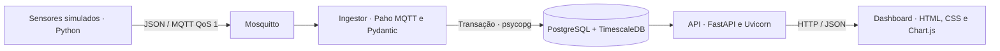

# IoT Industrial em Tempo Real

Projeto acadêmico de Engenharia da Computação para a disciplina **Tratamento e Armazenamento da Informação — FACAMP**. A aplicação simula sensores de equipamentos industriais, transmite leituras por MQTT, armazena séries temporais e apresenta indicadores, gráficos e alarmes em um dashboard.

As medições são simuladas; não há conexão com equipamentos físicos.

## Funcionalidades

- Seis sensores com intervalos de coleta próprios e publicação MQTT com QoS 1.
- Validação das mensagens, gravação em lotes e tratamento de retransmissões.
- Histórico temporal, limites configuráveis e alarmes WARN/CRITICAL com encerramento.
- API com consultas de leituras, agregações por minuto e saúde dos serviços.
- Dashboard em português, com atualização automática e indicação de dados desatualizados.
- Testes unitários e integrados, recuperação de falhas e conferência de restauração de backup.

## Arquitetura e tecnologias



PostgreSQL 16 com TimescaleDB 2.18.2 armazena as cinco tabelas do projeto. Python 3.12.10 é a base da imagem da aplicação. Paho MQTT faz a comunicação com o broker; Pydantic valida as leituras; psycopg acessa o banco. FastAPI serve a API e os arquivos estáticos. Chart.js 4.4.8 está incluído no projeto, sem CDN em tempo de execução. Docker Compose coordena os cinco serviços; pytest executa os testes unitários.

O ingestor grava telemetria e transições de alarme na mesma transação. Leituras válidas recebem ACK após o commit; mensagens inválidas são rejeitadas e registradas. A chave `(sensor_id, time)` evita duplicar a mesma leitura. Mensagens antigas entram no histórico sem alterar o alarme atual.

## Estrutura

```text
app/                 Simulador, ingestão, validação, persistência e API
sql/                 Esquema, cadastro inicial e privilégios do banco
mosquitto/           Configuração do broker local
dashboard/           Interface e Chart.js com sua licença
scripts/             Configuração, integração, resiliência, backup e consultas
tests/               Testes unitários e de contratos HTTP
docs/                Requisitos, demonstração, testes e licenças
  references/        Materiais didáticos originais
evidence/            Capturas selecionadas; resultados locais dos testes
compose.yml          Serviços, rede, volumes e verificações de saúde
Dockerfile           Imagem compartilhada por API, simulador e ingestor
.env.example         Modelo seguro das variáveis de ambiente
ESPECIFICACAO.md      Escopo e critérios internos de implementação
```

## Pré-requisitos

- Git para clonar o repositório.
- Docker Engine com Docker Compose v2 ou superior, ou Docker Desktop com Compose, em execução.
- Python 3.11 ou superior no host para gerar a configuração e executar os scripts de verificação.
- Portas locais 8000 e 1883 disponíveis e memória/disco suficientes para os containers.

A primeira instalação precisa de internet para baixar imagens e dependências. A execução foi verificada em macOS com Docker Desktop e containers Linux arm64. Podman e Windows não foram validados. No Windows, use os comandos Docker no PowerShell e substitua `python3` por `py -3`, quando esse for o comando Python disponível.

## Executar a partir de uma instalação limpa

### 1. Clonar e configurar

```sh
git clone https://github.com/FSakaida/iot-industrial-tempo-real.git
cd iot-industrial-tempo-real
python3 scripts/setup.py
```

O script cria `.env` a partir de `.env.example`, gera duas senhas aleatórias e restringe a permissão do arquivo. Se `.env` já existir, ele é preservado. Não envie esse arquivo ao repositório.

### 2. Construir e iniciar os serviços

```sh
docker compose config --quiet
docker compose up -d --build --wait
docker compose ps
```

O build instala as dependências fixadas em `requirements.lock`. O Compose inicia `db`, `mosquitto`, `api`, `ingestor` e `simulator`; não é necessário executar os três programas Python separadamente.

Na primeira inicialização de um volume vazio, o PostgreSQL executa os arquivos de `sql/` em ordem: cria a extensão TimescaleDB, as tabelas e índices, cadastra três ativos e seis sensores e configura o usuário da aplicação. Nas próximas inicializações, os dados são preservados. Alterar o cadastro SQL não atualiza automaticamente um volume existente.

### 3. Acessar e conferir a coleta

- Dashboard: <http://localhost:8000/>
- Documentação interativa da API: <http://localhost:8000/docs>
- Saúde dos serviços: <http://localhost:8000/health>
- Leituras e contagem de registros: <http://localhost:8000/api/overview>

```sh
docker compose logs --tail=20 simulator ingestor
```

O simulador registra `published`; o ingestor registra `batch_committed`, com a quantidade recebida e inserida. A contagem de leituras no dashboard deve crescer. Para acompanhar as mensagens, execute o comando abaixo e encerre com Ctrl+C:

```sh
docker compose exec mosquitto mosquitto_sub -t 'facamp/industrial/#' -q 1 -v
```

Se as portas estiverem ocupadas, altere `API_PORT` e `MQTT_PORT` em `.env`, execute novamente `docker compose up -d` e ajuste a URL do navegador. O banco não publica uma porta no host.

## Sensores e alarmes

| Ativo | Sensores | Intervalo nominal | Limites altos WARN / CRITICAL |
|---|---|---|---|
| MOTOR-07 | Temperatura e vibração | 2 s | Temperatura: 75 / 85 °C; vibração: 4,5 / 7 mm/s |
| COMP-02 | Pressão e temperatura | 5 s | Pressão: 8,2 / 9 bar; temperatura sem limites |
| BOMBA-03 | Corrente e vazão | 5 s | Sem limites configurados |

As comparações são estritas: 75 °C é normal, acima de 75 °C até 85 °C é WARN e acima de 85 °C é CRITICAL. Não há histerese. Leituras de qualidade zero não abrem nem encerram alarmes. ACK significa reconhecimento e não normalização. A mudança de severidade fecha a ocorrência anterior e abre outra; o retorno à faixa normal encerra a ocorrência ativa.

### Demonstrar atenção e criticidade

No dashboard, selecione **MOTOR-07 → Temperatura** e acompanhe também a tabela de alarmes. No terminal:

```sh
docker compose stop simulator
docker compose run --rm --no-deps api python -m app.simulator --scenario --step-seconds 8
docker compose start simulator
```

O cenário publica **68 → 78 → 88 → 70 °C** pelo MQTT, com oito segundos entre as etapas. O simulador contínuo fica pausado para evitar que uma leitura normal encerre o alarme durante a demonstração. O último comando retoma a coleta normal; execute-o também se interromper o cenário com Ctrl+C. Fora desse cenário, a simulação gera pequenas oscilações em torno dos valores normais e não agenda superaquecimentos periódicos.

Os eventos podem ser consultados em <http://localhost:8000/api/alarms>. Para conferir no banco, abra uma sessão SQL:

```sh
docker compose exec db sh -c 'psql -U "$POSTGRES_USER" -d "$POSTGRES_DB"'
```

```sql
SELECT sensor_id, severity, state, value, opened_at, closed_at
FROM alarms ORDER BY opened_at DESC LIMIT 10;
SELECT count(*) FROM telemetry;
```

Encerre a sessão com `\q`.

## Testes

Crie um ambiente virtual e instale as dependências de desenvolvimento. Em macOS/Linux:

```sh
python3 -m venv .venv
. .venv/bin/activate
python -m pip install -r requirements-dev.txt
python -m pytest -q
```

No PowerShell, use `py -3 -m venv .venv` e execute os comandos seguintes com `.\.venv\Scripts\python.exe`, sem precisar ativar o ambiente.

Com o ambiente virtual ativo e os serviços iniciados, execute a verificação completa:

```sh
python scripts/verify.py
```

Ela executa os testes unitários, valida o Compose, verifica MQTT/banco/API, simula indisponibilidade do banco e reconexão do broker, restaura um backup em outro banco e registra consultas SQL. O simulador é retomado ao final. A suíte acrescenta leituras e alarmes de teste e interrompe temporariamente serviços deste projeto; não a execute durante uma apresentação.

Os resultados ficam em `evidence/verification.json`, `evidence/pytest.xml` e arquivos de saída associados. Esses relatórios, logs e backups são gerados localmente e não são versionados. As capturas incluídas no repositório são registros de inspeções anteriores; a suíte não automatiza a verificação visual. Cobertura e limites: [docs/TESTES.md](docs/TESTES.md).

## Backup e operação

```sh
python3 scripts/backup_restore.py
```

O script pausa o simulador, cria `evidence/iot_industrial.dump`, restaura em um banco `facamp_restore_` com sufixo UTC e compara contagens e assinaturas do conteúdo das cinco tabelas. O banco original é preservado e o simulador é retomado ao final. O banco restaurado permanece disponível para inspeção. Não há agendamento automático de backup.

Para parar e reiniciar preservando os volumes:

```sh
docker compose down
docker compose up -d --wait
```

Não use `docker compose down -v` na operação normal: essa opção apaga os volumes. Para consultar o plano de execução e as agregações, veja `scripts/queries.sql`. As variáveis `BATCH_MAX`, `FLUSH_SECONDS`, `DB_RETRIES` e `SIM_INTERVAL_FACTOR` ficam em `.env`; alterações exigem recriar os serviços com `docker compose up -d`. O fator 1 mantém os intervalos nominais do cadastro.

## Segurança e limitações

Esta configuração é de laboratório local. API e MQTT são publicados em `127.0.0.1`; o banco fica na rede interna do Compose. Há usuário de aplicação com privilégios restritos e SQL parametrizado. A API não tem autenticação; o broker aceita acesso anônimo, sem TLS ou ACL por tópico. Antes de qualquer exposição externa, esses controles e a segmentação de rede precisam ser definidos e verificados.

O buffer de ingestão e parte do estado MQTT são mantidos em memória. QoS 1 e idempotência não garantem entrega exatamente uma vez nem durabilidade após falha completa de processo ou host. Não foram validados capacidade industrial, carga elevada, aparelhos físicos ou metas de recuperação. O dashboard consulta novamente três segundos após a consulta anterior terminar e sinaliza leituras antigas; não há garantia de tempo real rígido.

## Documentação e licenças

- [Matriz de requisitos](docs/REQUISITOS.md) e [especificação técnica](ESPECIFICACAO.md).
- [Roteiro de apresentação](docs/DEMONSTRACAO.md), [testes](docs/TESTES.md) e [desempenho observado](docs/DESEMPENHO.md).
- [Histórico e limitações](docs/PROGRESS.md) e [revisão para publicação](docs/REVISAO.md).
- [Ferramentas e licenças](docs/LICENCAS.md).

TimescaleDB Community inclui componentes Apache 2.0 e componentes sob Timescale License; não é integralmente licenciado sob termos reconhecidos pela OSI. Docker Desktop tem condições próprias de uso. Os avisos dos componentes de terceiros foram preservados, incluindo a licença do Chart.js distribuída com o código. Esta revisão não atribui uma licença ao código original do projeto; essa decisão cabe aos responsáveis.
